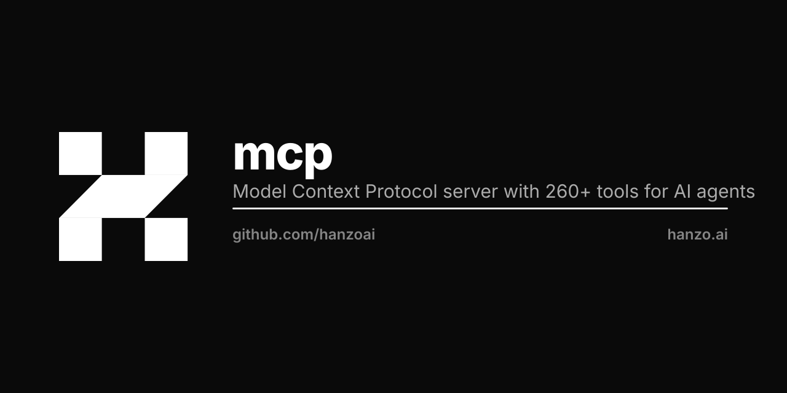

<p align="center"></p>

# Hanzo MCP

[](https://www.npmjs.com/package/hanzo)
[](https://modelcontextprotocol.io)
[](LICENSE)
[](https://api.hanzo.ai)

The official **Model Context Protocol (MCP)** server for coding agents, autonomous workflows, and tool orchestration. 

It exposes 260+ capabilities collapsed into high-efficiency action-routed tools over **stdio** or **HTTP/SSE** (`hanzo mcp -t sse`), plus native integration with the **Kai Agent Governance & Decision Engine**.

---

## Install

One install, any OS (Windows included):

```bash
npm i -g hanzo                      # or, on macOS/Linux: curl -fsSL https://hanzo.sh | sh
hanzo auth login                    # sign in
```

`npm i -g hanzo` installs a small launcher. Each native Rust binary is downloaded on
first use and its SHA-256 checked:

| Command | What it runs |
| :--- | :--- |
| `hanzo mcp` | this MCP server (native Rust `hanzo-mcp`) over stdio; `hanzo mcp -t sse` serves HTTP/SSE |
| `hanzo dev` | the [Hanzo Dev](https://github.com/hanzoai/dev) agent, with this server attached |
| `hanzo engine serve <model>` | local inference ([Hanzo Engine](https://github.com/hanzoai/engine)) |
| `hanzo` | a coding session |

The native server takes no `serve` subcommand (`hanzo mcp serve` is tolerated).

## Client Configuration

Nothing needs to be installed first: `npx -y hanzo mcp` fetches the launcher and the server.

### 1. Claude Code

```bash
claude mcp add --scope user hanzo -- npx -y hanzo mcp
claude mcp list
```

### 2. Codex

```bash
codex mcp add hanzo -- npx -y hanzo mcp
```

### 3. Hanzo Dev (`hanzo dev`)

[Hanzo Dev](https://github.com/hanzoai/dev) ([dev.chat](https://dev.chat)) attaches this server by default:

```bash
hanzo dev
```

### 4. Cursor, Windsurf, Zed, and VS Code

Add to your `mcpServers` configuration (`~/.cursor/mcp.json` or project `.mcp.json`):

```json
{
  "mcpServers": {
    "hanzo": {
      "command": "npx",
      "args": ["-y", "hanzo", "mcp"]
    }
  }
}
```

Once you have run `hanzo auth login`, the server uses that sign-in; set `HANZO_API_KEY`
in an `env` block only to override it.

### 5. Over HTTP (SSE)

For remote or multi-agent deployments:

```bash
hanzo mcp -t sse --port 3333
```

### 6. Choosing tools

Every tool schema the server lists is sent to the model on each turn. Serve only the ones you use:

```bash
claude mcp add --scope user hanzo -- npx -y hanzo mcp --tools fs,code,exec
```

Run `hanzo mcp --help` for every option (`--project-dir`, `--transport`, `--port`, `--tools`).

---

## Tool Catalog

Tool names and action schemas are the same in every runtime; [LLM.md](LLM.md) has the per-tool parity table:

| Group | Tools | Description |
| :--- | :--- | :--- |
| **core** | `fs`, `exec`, `code`, `git`, `fetch`, `workspace`, `ui` | File read/write, shell execution, AST code edits, git operations, HTTP calls, UI components. |
| **optional** | `think`, `memory`, `hanzo`, `plan`, `tasks`, `mode`, `gimp` | CoT scratchpads, semantic memory, Hanzo Cloud resource dispatch, task coordination, canvas. |
| **code intelligence** | `code_search`, `code_context`, `code_ask`, `code_index` | Dense vector code search, symbol index lookup, context graph resolution. |
| **tracker** | `tracker_boards`, `tracker_issues`, `tracker_create`, `tracker_update` | Visible engineering work items and live session status tracking on `hanzo.app`. |
| **coding** | `coding` (`start`, `progress`, `changes`, `artifacts`, `tree`, `blob`, `steer`, `merge`, `stop`) | Autonomous coding runs: a repo and a task in, a pushed branch out; a pull request when the work is ready (Rust runtime). |
| **kai (governance)** | `kai_decide`, `kai_choice`, `kai_score`, `kai_noul`, `kai_tool_select`, `kai_next_action`, `kai_command_guard`, `kai_injection_screen`, `kai_extract`, `kai_log_triage`, `kai_recover`, `kai_agent_step` | Typed policy evaluation, behavioral consistency benchmarking, command guards, failure recovery. The native server carries `kai_decide`; the rest are in the TypeScript server (below). |

### The `hanzo` Cloud Dispatcher

The unified `hanzo` tool gives agents access to all 2,400+ endpoints across the Hanzo Cloud platform:
- `resource`: Names the subsystem (e.g., `models`, `graph`, `iam`, `kms`, `billing`, `chain`, `network`).
- `action`: Names the operation. Calling with no action lists available operations.
- `args`: Arguments passed to the operation.

```json
{
  "resource": "models",
  "action": "list",
  "args": {}
}
```

### Kai Decision Primitives & Local Acceleration

Kai tools ask Hanzo's decision model typed questions (`POST /v1/decisions` on `https://api.hanzo.ai` or a local instance via `LOCAL_KAI_URL=http://127.0.0.1:8080`) and return calibrated probabilities and audit rationales:
Only `kai_decide` is in the native server; the others below are served by the TypeScript server.

- `kai_choice`: Multi-class categorical decision matching policy criteria.
- `kai_score`: Ordinal scoring and confidence assessment.
- `kai_noul`: Evaluates the probability that a behavioral statement holds true.
- `kai_command_guard`: Pre-execution command check (ALLOW, ASK, or DENY).
- `kai_injection_screen`: Prompt injection and jailbreak barrier.
- `kai_decide`: Batch evaluation of up to 100 questions in a single call.

See the [cookbook](cookbook/README.md) for 15+ runnable recipes.

---

## TypeScript server (`@hanzo/mcp`)

The TypeScript runtime is still published as [`@hanzo/mcp`](https://www.npmjs.com/package/@hanzo/mcp)
(Node 18+) for anyone who wants it specifically, e.g. for the `kai_*` governance tools the
[cookbook](cookbook/README.md) uses: `npx -y @hanzo/mcp serve`. Its own flags (`--core-only`,
`--disable-tools <names>`, `--enable-ui`, `--enable-desktop`, `--full-surface`) are listed by
`npx -y @hanzo/mcp serve --help`.

---

## Sibling Implementations

- **Python**: [`hanzo-mcp`](https://pypi.org/project/hanzo-mcp/) on PyPI, built from [`hanzoai/python-sdk`](https://github.com/hanzoai/python-sdk).
- **Rust**: the native server is [`rust/`](rust) in this repo (`hanzo mcp`); a native MCP client crate lives under [`hanzo-rs/sdk`](https://github.com/hanzo-rs/sdk).
- **Go**: High-throughput MCP provider under [`hanzo-go/sdk`](https://github.com/hanzo-go/sdk).

---

## Development & Testing

```bash
pnpm install
pnpm build
pnpm smoke    # runs smoke integration over stdio: initialize, tools/call, resources
```

---

## Company & Leadership

Hanzo AI is co-led by Co-CEOs **Antje Worring** and **Zach Kelling**.

- **Antje Worring**: Co-CEO ([LinkedIn](https://www.linkedin.com/in/antje-worring/) · [GitHub: zooqueen](https://github.com/zooqueen)) — corporate leadership, operations, ecosystem partnerships, and strategic execution.
- **Zach Kelling**: Co-CEO & Founding CTO ([LinkedIn](https://www.linkedin.com/in/zeekay/) · [GitHub: zeekay](https://github.com/zeekay)) — foundational architecture, engineering, systems, and open-source models.
- **Corporate Address**: 1 Ferry Building, San Francisco, CA 94105
- **Inquiries**: [dev@hanzo.ai](mailto:dev@hanzo.ai) · [support@hanzo.ai](mailto:support@hanzo.ai)

---

## License

MIT — see [LICENSE](LICENSE).
