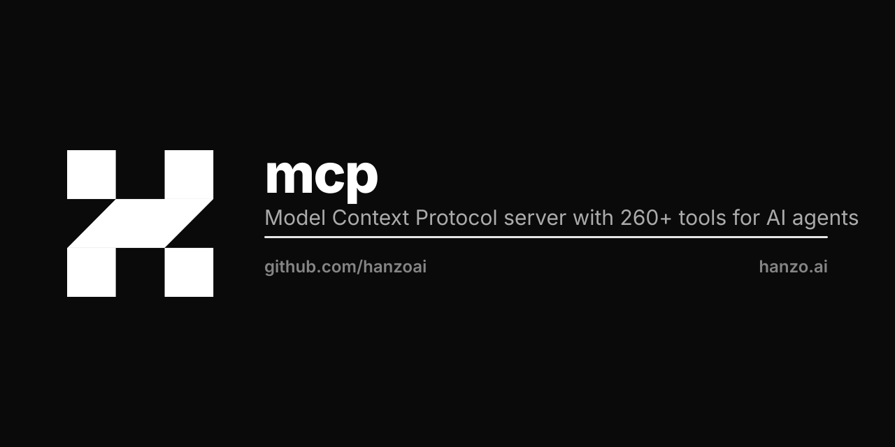

<p align="center"></p>

# @hanzo/mcp

[](https://www.npmjs.com/package/@hanzo/mcp)
[](https://modelcontextprotocol.io)
[](LICENSE)
[](https://api.hanzo.ai)

The official **Model Context Protocol (MCP)** server for coding agents, autonomous workflows, and tool orchestration. 

It exposes 260+ capabilities collapsed into high-efficiency action-routed tools over **stdio** or streamable **HTTP/SSE** (`--transport http`), plus native integration with the **Kai Agent Governance & Decision Engine**.

---

## Quick Setup & Client Configuration

The package requires Node 18 or newer.

### 1. Claude Code

Register globally for all projects:
```bash
npx -y @hanzo/mcp install --claude-code
# or manually:
claude mcp add --scope user hanzo -- npx -y @hanzo/mcp serve
```

Verify with:
```bash
claude mcp list
# reports: hanzo: npx -y @hanzo/mcp serve - ✔ Connected
```

### 2. Hanzo Dev (`hanzo dev`)

[Hanzo Dev](https://github.com/hanzoai/dev) ([dev.chat](https://dev.chat)) comes pre-wired with `@hanzo/mcp` by default. You can also attach custom server flags:

```bash
hanzo dev
# or within any repo session:
/mcp add hanzo -- npx -y @hanzo/mcp serve
```

### 3. Cursor, Windsurf, Zed, and VS Code

Add to your `mcpServers` configuration (`~/.cursor/mcp.json` or project `.mcp.json`):

```json
{
  "mcpServers": {
    "hanzo": {
      "command": "npx",
      "args": ["-y", "@hanzo/mcp", "serve"],
      "env": {
        "HANZO_API_KEY": "sk-..."
      }
    }
  }
}
```

### 4. Over Streamable HTTP (SSE)

For remote or multi-agent deployments, serve over HTTP with Server-Sent Events:

```bash
npx -y @hanzo/mcp serve --transport http --port 3000
```
POST JSON-RPC requests to `http://127.0.0.1:3000/` with header `Accept: application/json, text/event-stream`.

---

## Tool Catalog

Running `serve` with default flags registers the complete action-routed tool catalog defined in `src/tools/unified/index.ts`:

| Group | Tools | Description |
| :--- | :--- | :--- |
| **core** | `fs`, `exec`, `code`, `git`, `fetch`, `workspace`, `ui` | File read/write, shell execution, AST code edits, git operations, HTTP calls, UI components. |
| **optional** | `think`, `memory`, `hanzo`, `plan`, `tasks`, `mode`, `gimp` | CoT scratchpads, semantic memory, Hanzo Cloud resource dispatch, task coordination, canvas. |
| **code intelligence** | `code_search`, `code_context`, `code_ask`, `code_index` | Dense vector code search, symbol index lookup, context graph resolution. |
| **tracker** | `tracker_boards`, `tracker_issues`, `tracker_create`, `tracker_update` | Visible engineering work items and live session status tracking on `hanzo.app`. |
| **kai (governance)** | `kai_decide`, `kai_choice`, `kai_score`, `kai_noul`, `kai_tool_select`, `kai_next_action`, `kai_command_guard`, `kai_injection_screen`, `kai_extract`, `kai_log_triage`, `kai_recover`, `kai_agent_step` | Typed policy evaluation, behavioral consistency benchmarking, command guards, failure recovery. |

### The `hanzo` Cloud Dispatcher

The unified `hanzo` tool gives agents access to all 2,400+ endpoints across the Hanzo Cloud platform:
- `resource`: Names the subsystem (e.g., `models`, `graph`, `iam`, `kms`, `billing`, `chain`, `network`).
- `action`: Names the operation. Calling with no action lists available operations.
- `args`: Arguments passed to the operation.

```json
{
  "resource": "models",
  "action": "list",
  "args": {}
}
```

### Kai Decision Primitives & Local Acceleration

Kai tools ask Hanzo's decision model typed questions (`POST /v1/decisions` on `https://api.hanzo.ai` or a local instance via `LOCAL_KAI_URL=http://127.0.0.1:8080`) and return calibrated probabilities and audit rationales:
- `kai_choice`: Multi-class categorical decision matching policy criteria.
- `kai_score`: Ordinal scoring and confidence assessment.
- `kai_noul`: Evaluates the probability that a behavioral statement holds true.
- `kai_command_guard`: Pre-execution command check (ALLOW, ASK, or DENY).
- `kai_injection_screen`: Prompt injection and jailbreak barrier.
- `kai_decide`: Batch evaluation of up to 100 questions in a single call.

See the [cookbook](cookbook/README.md) for 15+ runnable recipes.

---

## Server Flags & Custom Surfaces

Customize the active tool surface using command-line flags:

| Flag | Effect |
| :--- | :--- |
| `--core-only` | Exposes only the core tools (`fs`, `exec`, `code`, `git`, `fetch`, `workspace`, `ui`). |
| `--disable-tools <names>` | Comma-separated list of tools to disable (e.g. `--disable-tools plan,tasks`). |
| `--enable-ui` | Registers individual `ui_*` web and component inspection tools. |
| `--enable-desktop` | Enables OS GUI automation (`hanzo_desktop`, `playwright_control`). |
| `--full-surface` | Enables all UI, AutoGUI, orchestration, registry, and GitHub toolsets together. |

List all options:
```bash
npx -y @hanzo/mcp serve --help
```

---

## Sibling Implementations

- **Python**: [`hanzo-mcp`](https://pypi.org/project/hanzo-mcp/) on PyPI, built from [`hanzoai/python-sdk`](https://github.com/hanzoai/python-sdk).
- **Rust**: Latency-optimized native MCP client crate under [`hanzo-rs/sdk`](https://github.com/hanzo-rs/sdk).
- **Go**: High-throughput MCP provider under [`hanzo-go/sdk`](https://github.com/hanzo-go/sdk).

---

## Development & Testing

```bash
pnpm install
pnpm build
pnpm smoke    # runs smoke integration over stdio: initialize, tools/call, resources
```

---

## Company & Leadership

Hanzo AI is co-led by Co-CEOs **Antje Worring** and **Zach Kelling**.

- **Antje Worring**: Co-CEO ([LinkedIn](https://www.linkedin.com/in/antje-worring/) · [GitHub: zooqueen](https://github.com/zooqueen)) — corporate leadership, operations, ecosystem partnerships, and strategic execution.
- **Zach Kelling**: Co-CEO & Founding CTO ([LinkedIn](https://www.linkedin.com/in/zeekay/) · [GitHub: zeekay](https://github.com/zeekay)) — foundational architecture, engineering, systems, and open-source models.
- **Corporate Address**: 995 Market St, San Francisco, CA 94103
- **Inquiries**: [dev@hanzo.ai](mailto:dev@hanzo.ai) · [support@hanzo.ai](mailto:support@hanzo.ai)

---

## License

MIT — see [LICENSE](LICENSE).
